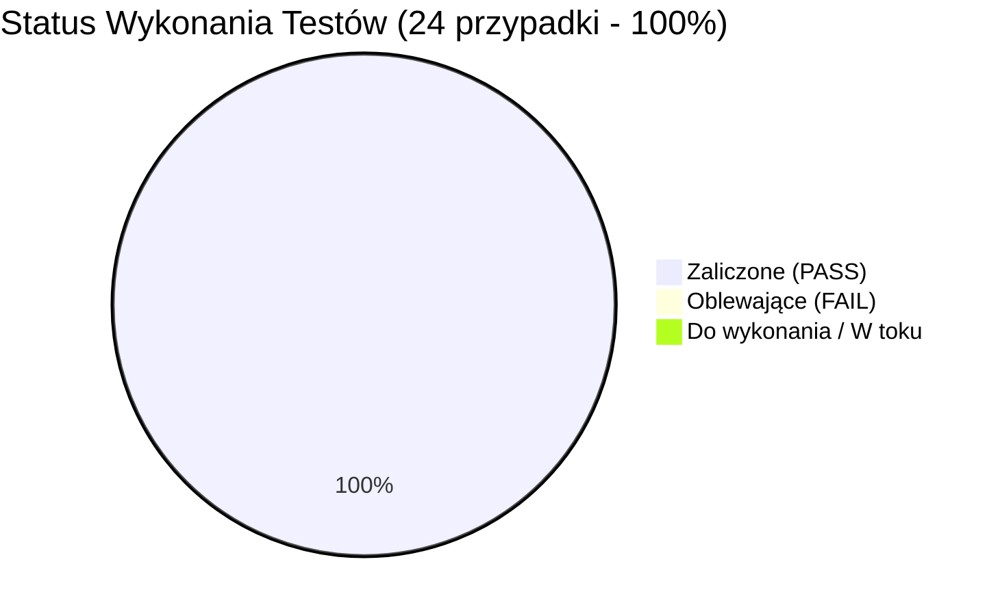

# Raport z Wykonania Testów Manualnych (Test Execution Report)
## Projekt: MacroGuard 

| **Tester odpowiedzialny:** | Dawid (Junior QA Automation Engineer) |
| **Data wykonania:** | Październik 2026 |
| **Środowisko:** | Windows 10 Home 64-bit \| Google Chrome 155.0.8059.80 \| Emulacja mobilna DevTools: Samsung Galaxy S20 Ultra (412x915) |
| **Baza przypadków testowych:** | [`TEST_CASES.md`](24 przypadki testowe) |
| **Status cyklu testowego:** | 🟢 Zakończony sukcesem (100% Zrealizowano) |

---

## 1. Podsumowanie Wyników (Execution Metrics)

| Metryka | Wartość | Uwagi |
|---|---|---|
| **Wszystkie przypadki testowe:** | **24** | Zdefiniowane w specyfikacji `TEST_CASES.md` |
| **Wykonane:** | **24 / 24 (100.0%)** | Wszystkie zaplanowane testy zostały zrealizowane |
| **Zaliczone (PASS 🟢):** | **24 (100%)** | Zgodne z oczekiwanym rezultatem |
| **Niezaliczone (FAIL 🔴):** | **0** | Brak defektów blokujących |
| **Zablokowane (BLOCKED ⚪):** | **0** | Wszystkie testy były wykonalne |
| **Krytyczne błędy blokujące (P0):** | **0** | Wymóg wydania spełniony w 100% |

---

## 2. Szczegółowy Dziennik Wykonania (Detailed Execution Log)

### Moduł 1: Uwierzytelnianie, Autoryzacja & Bezpieczeństwo (AUTH)

| ID | Tytuł przypadku testowego | Priorytet | Status | Data & Tester | Rzeczywisty wynik i uwagi |
|---|---|---|---|---|---|
| `TC-AUTH-001` | Rejestracja nowego konta z wysyłką linku aktywacyjnego | `P0` | 🟢 PASS | 19.10.2026 \| Dawid | Zgodny z oczekiwanym w 100%. Formularz rejestracji wyświetla kartę informacyjną, wiadomość z tokenem trafia do Mailpita (port 8025). Zweryfikowano w konsoli DevTools: localStorage.getItem('macroguard_auth') zwraca null (brak nieuprawnionego logowania przed aktywacją). |
| `TC-AUTH-002` | Walidacja polityki haseł w czasie rzeczywistym | `P1` | 🟢 PASS | 19.10.2026 \| Dawid | Zgodny z oczekiwanym. Panel kryteriów hasła pojawia się dynamicznie po wpisaniu pierwszego znaku. Dla hasła niespełniającego reguł (np. 9 znaków) wskaźnik 'Min. 10 znaków' pozostaje szary/niezaliczony, a przycisk 'Utwórz darmowe konto' jest zablokowany (disabled). |
| `TC-AUTH-003` | Odrzucenie logowania przed aktywacją e-mail | `P1` | 🟢 PASS | 19.10.2026 \| Dawid | Zgodny z oczekiwanym. Przy próbie logowania przed aktywacją serwer odrzuca żądanie (403), a formularz prezentuje ostrzeżenie: "Adres e-mail nie został jeszcze aktywowany. Sprawdź swoją skrzynkę pocztową i kliknij w link aktywacyjny.". Użytkownik nie uzyskuje dostępu do aplikacji. |
| `TC-AUTH-004` | Pomyślna aktywacja konta przez link z e-maila | `P0` | 🟢 PASS | 19.10.2026 \| Dawid | Zgodny z oczekiwanym. Po kliknięciu linku aktywacyjnego w Mailpicie (port 8025) wyświetla się zielony komunikat o potwierdzeniu adresu. Formularz automatycznie przełącza się na zakładkę logowania z uzupełnionym e-mailem. |
| `TC-AUTH-005` | Blokada konta po 5 nieudanych próbach (Brute Force) | `P0` | 🟢 PASS | 19.10.2026 \| Dawid | Zgodny z oczekiwanym w 100%. Przy 4. błędnej próbie pojawia się ostrzeżenie o ostatniej szansie. Przy 5. i 6. próbie konto zostaje zablokowane na 5 minut (HTTP 423 Locked) z właściwym komunikatem – zablokowane również dla prawidłowego hasła w trakcie blokady. |
| `TC-AUTH-006` | Reset hasła przez e-mail i zdjęcie blokady konta | `P1` | 🟢 PASS | 19.10.2026 \| Dawid | Zgodny z oczekiwanym. Procedura resetu hasła przez link w Mailpit powoduje wyzerowanie licznika błędnych prób i pomyślne zalogowanie nowym hasłem. |
| `TC-AUTH-007` | Ochrona tras (`AuthGuard`) przed wejściem bez tokena | `P1` | 🟢 PASS | 19.10.2026 \| Dawid | Zgodny z oczekiwanym. Próba bezpośredniego otwarcia adresów /diary i /calculator w nowym oknie incognito (bez tokena) skutkuje automatycznym przekierowaniem na /auth. |

---

### Moduł 2: Profil & Kalkulator BMR / TDEE (CALC)

| ID | Tytuł przypadku testowego | Priorytet | Status | Data & Tester | Rzeczywisty wynik i uwagi |
|---|---|---|---|---|---|
| `TC-CALC-001` | Wyliczenie BMR i TDEE dla mężczyzny (redukcja -15%) | `P0` | 🟢 PASS | 19.10.2026 \| Dawid | Zgodny z oczekiwanym w 100%. Formuła Mifflina-St Jeor poprawnie wyliczyła BMR (1805 kcal), TDEE z mnożnikiem 1.55 (2798 kcal) oraz kalorie docelowe z deficytem -15% (2378 kcal). Profil pomyślnie zapisany w bazie. |
| `TC-CALC-002` | Ostrzeżenie medyczne przy deficycie schodzącym poniżej BMR | `P1` | 🟢 PASS | 19.10.2026 \| Dawid | Zgodny z oczekiwanym. Po przekroczeniu progu BMR (agresywny deficyt) aplikacja natychmiast wyświetla baner ostrzegawczy o potencjalnym zagrożeniu dla metabolizmu i zdrowia. |

---

### Moduł 3: Dziennik Żywieniowy & Obsługa Posiłków (DIARY)

| ID | Tytuł przypadku testowego | Priorytet | Status | Data & Tester | Rzeczywisty wynik i uwagi |
|---|---|---|---|---|---|
| `TC-DIARY-001` | Dodanie produktu z bazy do posiłku i aktualizacja sumy makro | `P0` | 🟢 PASS | 19.10.2026 \| Dawid | Zgodny z oczekiwanym. Po dodaniu 150g 'Jajko kurze całe (1 szt. ~ 55g) (Wiejskie)' posiłek i podsumowanie dnia poprawnie zaktualizowały się do 215 kcal (B: 18.9g, W: 1.0g, T: 14.2g). Wyświetlił się toast sukcesu. |
| `TC-DIARY-002` | Dodanie napoju z wyborem objętości w mililitrach (ml) | `P1` | 🟢 PASS | 19.10.2026 \| Dawid | Zgodny z oczekiwanym. Po wybraniu napoju jednostka przełącza się na ml z kafelkami szybkiego wyboru (150, 250, 330, 500 ml). Wybór 330 ml przelicza 138.6 kcal, a podsumowanie posiłku zaokrągla wartość do 139 kcal. |
| `TC-DIARY-003` | Usunięcie pojedynczej pozycji z posiłku | `P1` | 🟢 PASS | 19.10.2026 \| Dawid | Zgodny z oczekiwanym. Kliknięcie ikony kosza natychmiast usuwa pozycję z posiłku, odejmuje jej kalorie i makroskładniki z bilansu dnia oraz wyświetla toast potwierdzający. |
| `TC-DIARY-004` | Wyczyszczenie wszystkich pozycji z posiłku („Wyczyść wszystkie pozycje...”) | `P1` | 🟢 PASS | 19.10.2026 \| Dawid | Zgodny z oczekiwanym. Po kliknięciu przycisku 'Wyczyść wszystkie pozycje z tego posiłku' pojawia się modal z pytaniem i liczbą pozycji. Po zatwierdzeniu (OK) wszystkie pozycje zostają skasowane, a kalorie wyzerowane. |
| `TC-DIARY-005` | Anulowanie wyczyszczenia posiłku (`confirm` -> Anuluj) | `P2` | 🟢 PASS | 19.10.2026 \| Dawid | Zgodny z oczekiwanym. Kliknięcie 'Anuluj' w oknie dialogowym zamyka okno bez wysyłania żądania usunięcia – pozycje w posiłku pozostają w 100% nienaruszone. |
| `TC-DIARY-006` | Dodanie opcjonalnego posiłku i dynamiczny licznik w menu | `P1` | 🟢 PASS | 19.10.2026 \| Dawid | Zgodny z oczekiwanym. Dodanie 'II Śniadanie' wstawia kartę w porządku chronologicznym, a etykieta w navbarze natychmiast reaktywnie aktualizuje się na 'Dziennik (5 posiłków)'. |
| `TC-DIARY-007` | Kopiowanie posiłku z dnia poprzedniego („Kopiuj z wczoraj”) | `P1` | 🟢 PASS | 19.10.2026 \| Dawid | Zgodny z oczekiwanym. Kliknięcie 'Skopiuj ten posiłek z wczoraj' poprawnie pobiera i wstawia produkty z wczorajszego posiłku z zachowaniem gramatur i przeliczeniem kalorii. |

---

### Moduł 4: Baza Produktów Spożywczych (FOOD)

| ID | Tytuł przypadku testowego | Priorytet | Status | Data & Tester | Rzeczywisty wynik i uwagi |
|---|---|---|---|---|---|
| `TC-FOOD-001` | Wyszukiwanie produktów z filtrowaniem po kategoriach | `P1` | 🟢 PASS | 19.10.2026 \| Dawid | Zgodny z oczekiwanym. Po wybraniu kategorii 'Tłuszcze i Oleje' i wpisaniu 'Oliwa' wyniki precyzyjnie filtrują się tylko do produktów z tej kategorii (np. Oliwa z oliwek Extra Virgin). |
| `TC-FOOD-002` | Utworzenie własnego produktu spożywczego | `P1` | 🟢 PASS | 19.10.2026 \| Dawid | Zgodny z oczekiwanym. Utworzenie produktu 'Baton proteinowy karmelowy' w kategorii 'Odżywki i Przekąski' z makro (380 kcal, 32B/28W/12T) zapisuje się w bazie i produkt jest natychmiast wyszukiwalny. |

---

### Moduł 5: Własne Dania & Generator AI (SETS / AI)

| ID | Tytuł przypadku testowego | Priorytet | Status | Data & Tester | Rzeczywisty wynik i uwagi |
|---|---|---|---|---|---|
| `TC-SET-001` | Zapisanie posiłku jako szablonu („Moje Danie”) | `P1` | 🟢 PASS | 19.10.2026 \| Dawid | Zgodny z oczekiwanym. Kliknięcie ikony wstążki w nagłówku posiłku i nadanie nazwy zapisuje zestaw w bazie. Nowy zestaw pojawia się w zakładce 'Moje Zestawy' i można go wstawić 1-kliknięciem. |
| `TC-AI-001` | Wygenerowanie posiłku przez AI i dodanie do dziennika | `P2` | 🟢 PASS | 19.10.2026 \| Dawid | Zgodny z oczekiwanym. Generator AI na podstawie wolnego limitu kalorii proponuje posiłek ze składnikami i gramaturami, a kliknięcie 'Dodaj ten posiłek...' natychmiast wstawia je do Dziennika. |

---

### Moduł 6: Monitorowanie Wagi & Postępy (WGHT)

| ID | Tytuł przypadku testowego | Priorytet | Status | Data & Tester | Rzeczywisty wynik i uwagi |
|---|---|---|---|---|---|
| `TC-WGHT-001` | Zapisanie pomiaru wagi i weryfikacja wykresu SVG | `P1` | 🟢 PASS | 19.10.2026 \| Dawid | Zgodny z oczekiwanym. Zapisanie 79.2 kg z notatką dodaje wpis do tabeli, kafelek KPI aktualizuje się do 79.2 kg, a na wykresie liniowym SVG pojawia się punkt pomiarowy. |
| `TC-WGHT-002` | Aktualizacja wagi w tym samym dniu (Upsert) | `P2` | 🟢 PASS | 19.10.2026 \| Dawid | Zgodny z oczekiwanym. Ponowny zapis wagi w tym samym dniu (78.9 kg) poprawnie nadpisuje istniejący rekord (mechanizm upsert bez duplikatów w bazie). |

---

### Moduł 7: Raporty Okresowe & AI Coach (REP / COACH)

| ID | Tytuł przypadku testowego | Priorytet | Status | Data & Tester | Rzeczywisty wynik i uwagi |
|---|---|---|---|---|---|
| `TC-REP-001` | Wygenerowanie raportu okresowego (7 / 30 dni) i eksport do druku/PDF | `P1` | 🟢 PASS | 19.10.2026 \| Dawid | Zgodny z oczekiwanym. Modal agreguje dane tygodniowe i miesięczne, przelicza kafelki KPI, tabelę dzienną oraz wywołuje systemowe okno druku/zapisu do PDF. |
| `TC-COACH-001` | Generowanie analizy postępów i rekomendacji przez MacroGuard AI Coach | `P1` | 🟢 PASS | 19.10.2026 \| Dawid | Zgodny z oczekiwanym w 100%. Generowanie raportu trenera AI zwraca kompleksową analizę: werdykt, bilans kalorii, wskaźnik białka, trend wagi oraz trafne rekomendacje dietetyczne. Toast potwierdza wygenerowanie. |

---

## 3. Wnioski i Decyzja o Wydaniu (Release Sign-Off)

* **Wynik cyklu testowego:** **24 / 24 przypadki testowe zaliczone (100% PASS)**.
* **Krytyczne błędy blokujące (P0):** **0**.

