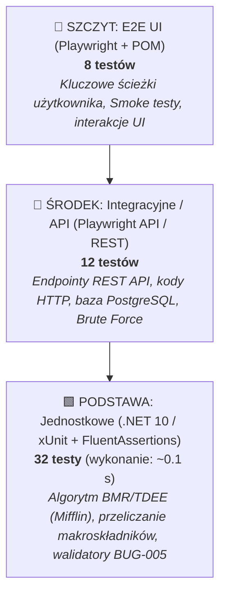

# Plan Testów i Strategia Zapewnienia Jakości (Test Plan & QA Strategy)
## Projekt: MacroGuard — Inteligentny Dziennik Żywieniowy & Kalkulator BMR/TDEE

| Metryka / Parametr | Wartość |
|:---|:---|
| **Autor dokumentu:** | Dawid (Junior QA Automation Engineer) |
| **Standard dokumentacji:** | Zgodny z ISTQB (International Software Testing Qualifications Board) |
| **Data utworzenia:** | Październik 2026 |
| **Repozytorium:** | `MacroGuard` (Monorepo: Backend .NET 10 + Frontend Angular 19) |

---

## 1. Wstęp i Cel Dokumentu (Introduction & Purpose)

Niniejszy dokument definiuje kompleksową strategię zapewnienia jakości (Quality Assurance) dla aplikacji **MacroGuard**. Określa zakres testowania, analizę ryzyka biznesowego, techniki projektowania przypadków testowych, wymagania środowiskowe oraz kryteria akceptacji oprogramowania.

Głównym celem procesu testowego jest zagwarantowanie:
1. **Niezawodności obliczeń żywieniowych:** Prawidłowość algorytmu kalkulatora BMR/TDEE (wzór Mifflin-St Jeor) oraz matematycznej spójności bilansu kalorii i makroskładników (B/W/T) w dzienniku.
2. **Bezpieczeństwa użytkowników i danych:** Weryfikacja mechanizmów autoryzacji (JWT), odporności na ataki typu Brute Force (blokada konta po 5 nieudanych próbach), weryfikacji adresów e-mail oraz restrykcyjnej polityki haseł.
3. **Integralności danych dziennika:** Ochrona przed przypadkowym usunięciem danych, poprawność modyfikacji posiłków i obsługa napojów (ml/g).
4. **Wysokiej jakości doświadczenia użytkownika (UX/UI):** Płynne działanie na urządzeniach desktopowych i mobilnych (RWD).

---

## 2. Zakres Testów (Scope of Testing)

### 2.1. Obszary objęte testami (In-Scope)
Testowaniu podlegają wszystkie kluczowe moduły funkcjonalne i niefunkcjonalne systemu:

1. **Moduł Uwierzytelniania, Autoryzacji i Bezpieczeństwa (Auth & Security):**
   - Rejestracja użytkownika z dynamiczną walidacją siły hasła (min. 10 znaków, wielka/mała litera, cyfra, znak specjalny).
   - Generowanie tokena weryfikacyjnego i przepływ aktywacji konta przez e-mail (brak możliwości logowania przed aktywacją).
   - Logowanie z mechanizmem ochrony przed atakami Brute Force (blokada konta na 5 minut po 5 nieudanych próbach, kod HTTP `423 Locked`).
   - Bezpieczne sesje oparte na tokenach JWT (podpisywanie symetrycznym kluczem kryptograficznym).
   - Reset hasła przez unikalny token e-mail.
   - Ochrona tras we frontendzie (`AuthGuard` blokujący nieautoryzowany dostęp do `/diary`, `/calculator`, `/stats`, `/guide`).

2. **Moduł Profilu i Kalkulatora BMR/TDEE:**
   - Wyliczanie podstawowej przemiany materii (BMR) oraz całkowitego zapotrzebowania (TDEE).
   - Konfiguracja celów sylwetkowych (Redukcja z wyborem deficytu -10% do -25%, Utrzymanie, Masa).
   - Prognoza czasu osiągnięcia wagi docelowej oraz weryfikacja ostrzeżenia przed zejściem poniżej BMR.

3. **Moduł Dziennika Żywieniowego (Core Diary Flow):**
   - Dodawanie produktów z bazy publicznej oraz produktów własnych.
   - Obsługa jednostek masy (gramy) oraz objętości płynów (mililitry dla kategorii *Napoje i Płyny*).
   - Przeliczanie sumy posiłków oraz sumy dobowej z paskami postępu kalorii i makroskładników.
   - Nowa funkcja: **Czyszczenie wszystkich pozycji z posiłku jednym kliknięciem (`delete_sweep`)** z obowiązkowym modalem potwierdzenia `confirm()`.
   - Obsługa posiłków stałych (*Śniadanie, Obiad, Przekąska, Kolacja*) oraz posiłków opcjonalnych (*II Śniadanie, Napoje i Płyny, Posiłek przedtreningowy*).
   - Dynamiczny licznik posiłków w pasku nawigacyjnym (`Dziennik (X posiłków)`).
   - Kopiowanie posiłków z dnia poprzedniego (*Kopiuj z wczoraj*).

4. **Moduł Bazy Produktów Spożywczych:**
   - Wyszukiwarka produktów z filtrowaniem po kategoriach.
   - Tworzenie własnych artykułów spożywczych z walidacją wartości odżywczych na 100g.

5. **Moduł Własnych Dań („Moje Dania”) & Generatora Przepisów AI:**
   - Zapisywanie skomponowanego posiłku jako szablonu zestawu dań.
   - Generowanie propozycji posiłku pod zadany limit kalorii i automatyczne dodanie do dziennika.

6. **Moduł Monitorowania Wagi i Postępów:**
   - Rejestracja pomiaru wagi z ograniczeniem do jednego wpisu na dobę (upsert).
   - Wyliczanie średnich tygodniowych (ISO week) oraz trendu tydzień do tygodnia.
   - Wizualizacja wykresu liniowego SVG i banera motywacyjnego.

7. **Testy REST API (Backend — Zakres Automatyzacji Playwright API):**
   - Weryfikacja poprawności kodów odpowiedzi HTTP (200, 201, 204, 400, 401, 403, 404, 423, 429).
   - Bezpośrednie testowanie endpointów backendu za pomocą klienta HTTP w Playwright (`playwright.request`) bez udziału interfejsu graficznego.
   - Weryfikacja nagłówków bezpieczeństwa i middleware Rate Limitingu (`10 req/min` na autoryzację).

---

### 2.2. Obszary wyłączone z zakresu (Out-of-Scope)
* Testy wydajnościowe powyżej 5 000 równoległych żądań na sekundę (ze względu na środowisko laboratoryjne).
* Płatne zewnętrzne bramki SMS / płatności (aplikacja nie posiada modułu płatności komercyjnych).
* Testy aplikacji natywnej Android/iOS (aplikacja jest dedykowana dla Web RWD).

---

## 3. Strategia Testów i Analiza Ryzyka (Risk-Based Testing)

Jakość oprogramowania w projekcie MacroGuard weryfikowana jest na zasadzie **testowania opartego na ryzyku (Risk-Based Testing)**. Priorytety testów wynikają z potencjalnego wpływu błędu na użytkownika (Impact) oraz prawdopodobieństwa jego wystąpienia (Probability).

### 3.1. Macierz Oceny Ryzyka (Risk Assessment Matrix 2x2)

Poniższa macierz klasyfikuje funkcjonalności aplikacji na podstawie dwóch kluczowych wymiarów: **Wpływu błędu na biznes i użytkownika (Impact)** oraz **Prawdopodobieństwa wystąpienia usterki (Probability)**:

| Wpływ Biznesowy (Impact) \ Prawdopodobieństwo (Probability) | Niskie Prawdopodobieństwo Błędu (Low Probability) | Wysokie Prawdopodobieństwo Błędu (High Probability) |
|---|---|---|
| **Krytyczny / Wysoki Wpływ (High Impact)** | **P1 — Wysokie Ryzyko (High Risk)** • Kalkulacje BMR / TDEE / Bilans Makro • Blokada Brute Force (5 prób / 5 min) • Aktywacja konta przez e-mail (Token) 👉 *Strategia:* Dokładne testy manualne + testy integracyjne API | **P0 / P1 — Ryzyko Krytyczne (Critical Risk)** • Dodawanie i edycja gramatur w Dzienniku • Autoryzacja i ochrona tras (`AuthGuard`) • Czyszczenie i zapis posiłków 👉 *Strategia:* Bezwzględny priorytet automatyzacji Playwright E2E |
| **Niski / Umiarkowany Wpływ (Low Impact)** | **P3 — Niskie Ryzyko (Low Risk)** • Szablony wydruku raportów A4 / PDF • Filtry kategorii produktów w oknie dodawania 👉 *Strategia:* Testy eksploracyjne i weryfikacja UI | **P2 — Średnie Ryzyko (Medium Risk)** • Dynamiczny licznik w navbarze • MacroGuard AI Coach (fallback regułowy) • Ulubione zestawy dań i kopiowanie posiłków 👉 *Strategia:* Weryfikacja regresyjna przy wdrożeniach |

### 3.2. Szczegółowa Tabela Punktacji Ryzyka (Risk Score Table)

Punktacja ryzyka wyliczana jest według uznanego wzoru ISTQB: **Risk Score = Wpływ (Impact: 1–5) × Prawdopodobieństwo (Likelihood: 1–5)**:

| Funkcjonalność / Moduł | Wpływ (1–5) | Prawdopodobieństwo (1–5) | Wynik Ryzyka (Score) | Priorytet Testu | Strategia / Podejście Testowe |
|---|:---:|:---:|:---:|:---:|---|
| **Dodawanie i edycja gramatur w Dzienniku** | 5 | 4 | **20** | `P0` | Automatyzacja Playwright E2E |
| **Logowanie, JWT & Ochrona tras (`AuthGuard`)** | 5 | 3 | **15** | `P0` | Automatyzacja E2E + API |
| **Kalkulacje BMR, TDEE i makroskładników** | 5 | 3 | **15** | `P0` | Automatyzacja E2E + Unit Testy |
| **Ochrona Brute Force (blokada po 5 próbach)** | 5 | 2 | **10** | `P0` | Testy bezpieczeństwa E2E + API |
| **Aktywacja konta przez e-mail (Mailpit)** | 4 | 2 | **8** | `P0` | Automatyzacja E2E (Mailpit API) |
| **MacroGuard AI Coach (rekomendacje)** | 3 | 3 | **9** | `P1` | Testy manualne / integracyjne |
| **Zapisywanie zestawów i kopiowanie dań** | 3 | 3 | **9** | `P1` | Automatyzacja Playwright E2E |
| **Dynamiczny licznik posiłków w navbarze** | 2 | 4 | **8** | `P2` | Weryfikacja regresyjna UI |
| **Filtry i wyszukiwarka produktów** | 2 | 2 | **4** | `P2` | Testy manualne eksploracyjne |
| **Szablony wydruku raportów okresowych A4** | 2 | 1 | **2** | `P2` | Weryfikacja wizualna / Print preview |

### 3.3. Architektura Piramidy Testów (Test Pyramid Architecture)

Zgodnie z uznanymi praktykami inżynierii oprogramowania (Mike Cohn / Martin Fowler), strategia testów w projekcie MacroGuard opiera się na 3-warstwowej **Piramidzie Testów**:

* **🟩 Warstwa 1 — Podstawa: Testy Jednostkowe (.NET 10 / xUnit):** Zlokalizowane w projekcie `backend/tests/MacroGuard.UnitTests`. Błyskawicznie weryfikują formuły matematyczne kalkulatora BMR/TDEE, przeliczanie gramatur i objętości napojów oraz reguły walidacji (32 testy, czas wykonania: ~106 ms).
* **🔷 Warstwa 2 — Środek: Testy Integracyjne / API (12 testów):** Weryfikacja kontraktów REST API, kodów błędów (403, 423 Locked), tokenów i operacji bazodanowych.
* **🔺 Warstwa 3 — Szczyt: Testy E2E (8 testów):** Testy krytycznych ścieżek użytkownika (Core Flows) w przeglądarce w oparciu o Playwright i wzorzec Page Object Model (POM).

---

## 4. Techniki Projektowania Testów (Test Design Techniques)

Do przygotowania scenariuszy testowych w `TEST_CASES.md` wykorzystano 4 fundamentalne techniki czarnoskrzynkowe (zgodne z sylabusem ISTQB). Poniższe punkty prezentują **reprezentatywne przykłady metodologii**, na bazie których opracowano pełną bazę przypadków testowych:

### 4.1. Podział na Klasy Równoważności (Equivalence Partitioning - EP)
Dzielimy dane wejściowe na grupy (klasy poprawne i niepoprawne), dla których aplikacja powinna zachować się w jednakowy sposób. Reprezentatywne przykłady podziału w projekcie:
* **Hasło użytkownika (walidacja złożoności):**
  - *Klasa Poprawna (KP1):* Hasło $\ge$ 10 znaków, min. 1 wielka litera, 1 mała, 1 cyfra, 1 znak specjalny (np. `MacroGuard2026!`).
  - *Klasa Niepoprawna (KN1):* Długość $< 10$ znaków (np. `Ab1!cde`).
  - *Klasa Niepoprawna (KN2):* Brak wielkiej litery (np. `macroguard2026!`).
  - *Klasa Niepoprawna (KN3):* Brak cyfry (np. `MacroGuardSecret!`).
  - *Klasa Niepoprawna (KN4):* Brak znaku specjalnego (np. `MacroGuard2026Pass`).
* **Waga porcji produktu (gramatura w Dzienniku):**
  - *Klasa Poprawna (KP1):* $1 \le x \le 5000$ g (wartości fizjologiczne porcji).
  - *Klasa Niepoprawna (KN1):* $x \le 0$ (wartości ujemne lub zero).
  - *Klasa Niepoprawna (KN2):* $x > 5000$ g (wartości nierealistyczne / overflow).
  - *Klasa Niepoprawna (KN3):* Wartości nieliczbowe (np. tekst, symbole).

### 4.2. Analiza Wartości Brzegowych (Boundary Value Analysis - BVA)
Testowanie wartości leżących dokładnie na krawędziach klas równoważności (tam statystycznie programiści popełniają najwięcej błędów typu *off-by-one*). Reprezentatywne przykłady w projekcie:
* **Długość hasła rejestracji:**
  - $9$ znaków $\rightarrow$ Wartość tuż poniżej granicy (Oczekiwane: Odrzucenie / Przycisk zablokowany).
  - $10$ znaków $\rightarrow$ Dokładna granica minimalna (Oczekiwane: Akceptacja).
  - $11$ znaków $\rightarrow$ Wartość tuż powyżej granicy (Oczekiwane: Akceptacja).
* **Deficyt kaloryczny w redukcji:**
  - $5\%$ $\rightarrow$ Minimalny dopuszczalny deficyt.
  - $25\%$ $\rightarrow$ Górny zalecany limit bezpiecznej redukcji.
  - $30\%$ $\rightarrow$ Przekroczenie progu bezpieczeństwa (Oczekiwane: Alert o zbyt agresywnej diecie).
* **Próg kalorii poniżej BMR:**
  - $BMR + 0$ kcal $\rightarrow$ Bilans równy BMR (Bezpieczny).
  - $BMR - 1$ kcal $\rightarrow$ Dokładne przekroczenie granicy (Oczekiwane: Natychmiastowe wyświetlenie banera medycznego).

### 4.3. Testowanie Przejść Między Stanami (State Transition Testing)
Weryfikacja cyklu życia encji w systemie:
* **Cykl życia konta użytkownika:**
  `Nowy Formularz` $\rightarrow$ `Rejestracja` $\rightarrow$ `Stan: Nieaktywowany (EmailConfirmed=false)` $\rightarrow$ `Próba logowania (Odrzucenie 403)` $\rightarrow$ `Użycie tokena aktywacyjnego` $\rightarrow$ `Stan: Aktywowany` $\rightarrow$ `Poprawne logowanie (Token JWT)`.
* **Cykl blokady konta (Brute-Force Lockout):**
  `Konto aktywne` $\xrightarrow{\text{1-4 błędne hasła}}$ `Ostrzeżenie o pozostałych próbach` $\xrightarrow{\text{5. błędne hasło}}$ `Stan: Zablokowane (Lockout 5 min / HTTP 423)` $\xrightarrow{\text{Upływ 5 min lub reset hasła}}$ `Stan: Odblokowane`.

### 4.4. Tablice Decyzyjne (Decision Tables)

Tablice decyzyjne stosowane są do testowania złożonych kombinacji reguł biznesowych oraz powiązań między warunkami wejściowymi a akcjami systemu. W MacroGuard tablice decyzyjne weryfikują m.in. kalkulator zapotrzebowania z ostrzeżeniami medycznymi oraz politykę bezpieczeństwa logowania:

#### Tablica Decyzyjna 1: Kalkulator BMR/TDEE & Dynamiczne Reguły Ostrzeżeń

| Element Tablicy | R1 (Mężczyzna - Utrzymanie) | R2 (Mężczyzna - Redukcja standard) | R3 (Kobieta - Agresywny deficyt) | R4 (Mężczyzna - Budowa masy) | R5 (Praca fizyczna - Redukcja) |
|---|:---:|:---:|:---:|:---:|:---:|
| **WARUNKI (Conditions):** | | | | | |
| **C1:** Płeć użytkownika | Mężczyzna | Mężczyzna | Kobieta | Mężczyzna | Dowolna |
| **C2:** Poziom aktywności (PAL) | Siedzący (1.2) | Umiarkowany (1.55) | Lekki (1.375) | Wysoki (1.725) | Praca fizyczna (1.6) |
| **C3:** Cel sylwetkowy | Utrzymanie (0%) | Redukcja (-15%) | Redukcja (-35%) | Masa (+10%) | Redukcja (-20%) |
| **C4:** Czy kalorie docelowe < BMR? | NIE | NIE | **TAK** | NIE | NIE |
| **AKCJE / WYNIK (Actions):** | | | | | |
| **A1:** Formuła BMR Mifflina | $+5$ kcal | $+5$ kcal | $-161$ kcal | $+5$ kcal | $+5$ / $-161$ kcal |
| **A2:** Wyliczenie TDEE | $BMR \times 1.2$ | $BMR \times 1.55$ | $BMR \times 1.375$ | $BMR \times 1.725$ | $BMR \times 1.6$ |
| **A3:** Docelowe kalorie | $TDEE$ | $TDEE \times 0.85$ | $TDEE \times 0.65$ | $TDEE \times 1.10$ | $TDEE \times 0.80$ |
| **A4:** Baner ostrzeżenia medycznego (< BMR) | ❌ Ukryty | ❌ Ukryty | ⚠️ **WYŚWIETLONY** | ❌ Ukryty | ❌ Ukryty |
| **A5:** Boks info o treningu oporowym | ❌ Ukryty | ❌ Ukryty | ❌ Ukryty | 🏋️ **WYŚWIETLONY** | ❌ Ukryty |
| **A6:** Zapis profilu w bazie | Sukces | Sukces | Sukces (z ostrzeżeniem) | Sukces | Sukces |

#### Tablica Decyzyjna 2: Logowanie i Blokada Anty-Brute Force

| Element Tablicy | R1 (Sukces) | R2 (Błędne hasło 1–3) | R3 (Ostatnia szansa) | R4 (Blokada konta) | R5 (Brak aktywacji) |
|---|:---:|:---:|:---:|:---:|:---:|
| **WARUNKI (Conditions):** | | | | | |
| **C1:** Poprawny adres e-mail | TAK | TAK | TAK | TAK | TAK |
| **C2:** E-mail potwierdzony (`EmailConfirmed`) | TAK | TAK | TAK | TAK | **NIE** |
| **C3:** Poprawne hasło | TAK | NIE | NIE | Dowolne | Dowolne |
| **C4:** Licznik błędnych prób | 0 | 1 – 3 | 4 | $\ge 5$ (w oknie 5 min) | Dowolny |
| **AKCJE / WYNIK (Actions):** | | | | | |
| **A1:** Wydanie tokena JWT i logowanie | ✅ TAK (HTTP 200) | ❌ NIE | ❌ NIE | ❌ NIE | ❌ NIE |
| **A2:** Komunikat błędu w UI | Brak | "Nieprawidłowe dane" | "Ostatnia szansa przed blokadą" | "Konto zablokowane na 5 minut" | "Potwierdź adres e-mail" |
| **A3:** Kod odpowiedzi HTTP | `200 OK` | `400 Bad Request` | `400 Bad Request` | `423 Locked` | `403 Forbidden` |
| **A4:** Inkrementacja licznika prób | Reset do 0 | $+1$ | $+1$ (osiągnięto 5) | Brak (zablokowane) | Brak zmian |

---

## 5. Środowisko Testowe (Test Environment & Architecture)

Testy realizowane są w wyizolowanym środowisku kontenerowo-lokalnym odpowiadającym architekturze docelowej:

| Komponent | Technologia / Narzędzie | Konfiguracja testowa |
|---|---|---|
| **Baza danych** | PostgreSQL 17 (Docker) | Port `5432`, kontener `macroguard_postgres` |
| **Serwer pocztowy (Dev/Test)** | Mailpit (Docker) | SMTP port `1025`, Web UI port `8025` (podgląd e-maili) |
| **Backend API** | .NET 10 ASP.NET Core Web API | Port `5000` (`http://localhost:5000/api`) |
| **Frontend SPA** | Angular 19 + Angular Material | Port `4200` (`http://localhost:4200`) |
| **Testy Jednostkowe (Unit)** | xUnit 2.9 + FluentAssertions 8.0 (.NET 10) | Projekt `backend/tests/MacroGuard.UnitTests` (32 testy, wykonanie: ~106 ms) |
| **Narzędzie do testów E2E** | Playwright / TypeScript | Tryb *headed* (lokalnie) oraz *headless* (CI) |
| **Narzędzie do testów API** | Playwright API / REST Client | Bezpośrednie wywołania endpointów HTTP |
| **Docelowa kompatybilność (Cross-Browser)** | Silniki Chromium (Google Chrome, Edge), Firefox, WebKit (Safari) | Desktop (1920x1080) + Mobile Viewport (412x915) |
| **Środowisko testów manualnych** | Google Chrome 155.0.8059.80 (Desktop) | DevTools Device Emulation: Samsung Galaxy S20 Ultra (412x915) |

---

## 6. Klasyfikacja Błędów i Priorytetyzacja (Defect Management)

Każde wykryte odstępstwo od wymagań klasyfikowane jest według standardowej skali:

### 6.1. Waga błędu (Severity)
* **S1 - Blocker:** Aplikacja nie działa, brak możliwości zalogowania, awaria bazy danych, utrata danych użytkownika.
* **S2 - Critical:** Kluczowa funkcja biznesowa nie działa (np. kalkulator nie zapisuje celów, brak możliwości dodania posiłku).
* **S3 - Major:** Funkcja działa nieprawidłowo, ale istnieje obejście (np. błąd formatowania wykresu wagi).
* **S4 - Minor:** Drobna usterka wizualna, literówka w opisie posiłku, drobne przesunięcie marginesu.

### 6.2. Priorytety przypadków testowych (Test Priorities)
* **P0 (Smoke / Sanity):** Krytyczne ścieżki, bez których aplikacja nie ma racji bytu. Wykonywane przy każdym wdrożeniu.
* **P1 (Critical Business):** Istotne reguły walidacji, bezpieczeństwo, poprawne kalkulacje makroskładników.
* **P2 (Normal Functional):** Funkcjonalności poboczne, filtry, generatory przepisów, szablony dań.
* **P3 (Low / Edge Case):** Nietypowe zachowania, skrajne wartości danych, specyficzne rozmiary ekranów.

---

## 7. Kryteria Wejścia i Wyjścia (Entry & Exit Criteria)

### 7.1. Kryteria wejścia do testów (Entry Criteria)
1. Kontenery bazy danych PostgreSQL oraz serwera Mailpit uruchomione bez błędów (`docker compose ps` = `healthy`).
2. Backend API kompiluje się z wynikiem `0 errors` i poprawnie wykonuje seed bazy danych.
3. Frontend Angular kompiluje się bez błędów (`ng build` = `success`).

### 7.2. Kryteria wyjścia (Zakończenie testów i akceptacja wydania)
1. **100% testów o priorytecie P0 i P1 zakończonych statusem PASS.**
2. Brak otwartych defektów o wadze *S1 (Blocker)* oraz *S2 (Critical)*.
3. Wszystkie wykonane scenariusze testowe posiadają udokumentowany wynik w `TEST_CASES_EXECUTION_REPORT.md`.

