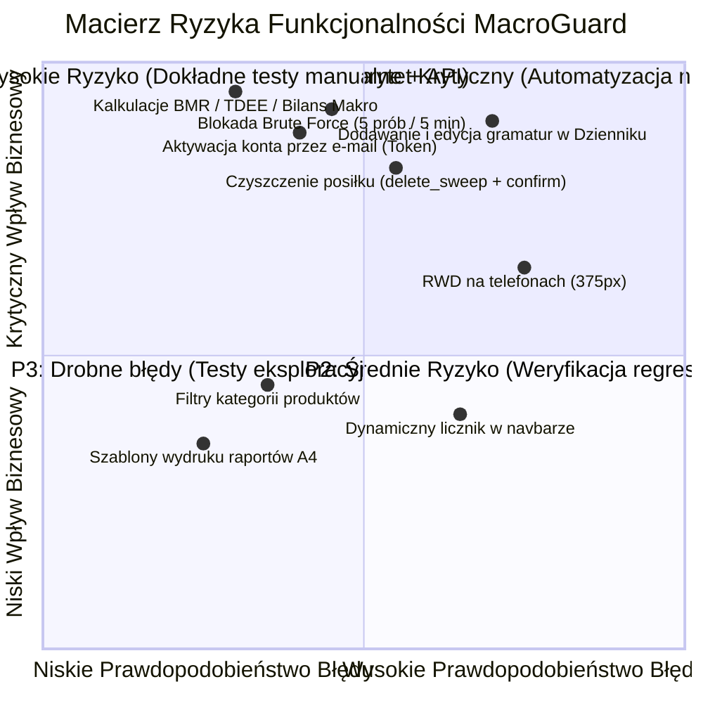

# Plan Testów i Strategia Zapewnienia Jakości (Test Plan & QA Strategy)
## Projekt: MacroGuard — Inteligentny Dziennik Żywieniowy & Kalkulator BMR/TDEE

| **Autor dokumentu:** | Dawid (Junior QA Automation Engineer) |
| **Standard dokumentacji:** | Zgodny z IEEE 829 / ISTQB |
| **Data utworzenia:** | Październik 2026 |
| **Repozytorium:** | `MacroGuard` (Monorepo: Backend .NET 10 + Frontend Angular 19) |

---

## 1. Wstęp i Cel Dokumentu (Introduction & Purpose)

Niniejszy dokument definiuje kompleksową strategię zapewnienia jakości (Quality Assurance) dla aplikacji **MacroGuard**. Określa zakres testowania, analizę ryzyka biznesowego, techniki projektowania przypadków testowych, wymagania środowiskowe oraz kryteria akceptacji oprogramowania.

Głównym celem procesu testowego jest zagwarantowanie:
1. **Niezawodności obliczeń żywieniowych:** Prawidłowość algorytmu kalkulatora BMR/TDEE (wzór Mifflin-St Jeor) oraz matematycznej spójności bilansu kalorii i makroskładników (B/W/T) w dzienniku.
2. **Bezpieczeństwa użytkowników i danych:** Weryfikacja mechanizmów autoryzacji (JWT), odporności na ataki typu Brute Force (blokada konta po 5 nieudanych próbach), weryfikacji adresów e-mail oraz restrykcyjnej polityki haseł.
3. **Integralności danych dziennika:** Ochrona przed przypadkowym usunięciem danych, poprawność modyfikacji posiłków i obsługa napojów (ml/g).
4. **Wysokiej jakości doświadczenia użytkownika (UX/UI):** Płynne działanie na urządzeniach desktopowych i mobilnych (RWD).

---

## 2. Zakres Testów (Scope of Testing)

### 2.1. Obszary objęte testami (In-Scope)
Testowaniu podlegają wszystkie kluczowe moduły funkcjonalne i niefunkcjonalne systemu:

1. **Moduł Uwierzytelniania, Autoryzacji i Bezpieczeństwa (Auth & Security):**
   - Rejestracja użytkownika z dynamiczną walidacją siły hasła (min. 10 znaków, wielka/mała litera, cyfra, znak specjalny).
   - Generowanie tokena weryfikacyjnego i przepływ aktywacji konta przez e-mail (brak możliwości logowania przed aktywacją).
   - Logowanie z mechanizmem ochrony przed atakami Brute Force (blokada konta na 5 minut po 5 nieudanych próbach, kod HTTP `423 Locked`).
   - Bezpieczne sesje oparte na tokenach JWT (podpisywanie symetrycznym kluczem kryptograficznym).
   - Reset hasła przez unikalny token e-mail.
   - Ochrona tras we frontendzie (`AuthGuard` blokujący nieautoryzowany dostęp do `/diary`, `/calculator`, `/stats`, `/guide`).

2. **Moduł Profilu i Kalkulatora BMR/TDEE:**
   - Wyliczanie podstawowej przemiany materii (BMR) oraz całkowitego zapotrzebowania (TDEE).
   - Konfiguracja celów sylwetkowych (Redukcja z wyborem deficytu -10% do -25%, Utrzymanie, Masa).
   - Prognoza czasu osiągnięcia wagi docelowej oraz weryfikacja ostrzeżenia przed zejściem poniżej BMR.

3. **Moduł Dziennika Żywieniowego (Core Diary Flow):**
   - Dodawanie produktów z bazy publicznej oraz produktów własnych.
   - Obsługa jednostek masy (gramy) oraz objętości płynów (mililitry dla kategorii *Napoje i Płyny*).
   - Przeliczanie sumy posiłków oraz sumy dobowej z paskami postępu kalorii i makroskładników.
   - Nowa funkcja: **Czyszczenie wszystkich pozycji z posiłku jednym kliknięciem (`delete_sweep`)** z obowiązkowym modalem potwierdzenia `confirm()`.
   - Obsługa posiłków stałych (*Śniadanie, Obiad, Przekąska, Kolacja*) oraz posiłków opcjonalnych (*II Śniadanie, Napoje i Płyny, Posiłek przedtreningowy*).
   - Dynamiczny licznik posiłków w pasku nawigacyjnym (`Dziennik (X posiłków)`).
   - Kopiowanie posiłków z dnia poprzedniego (*Kopiuj z wczoraj*).

4. **Moduł Bazy Produktów Spożywczych:**
   - Wyszukiwarka produktów z filtrowaniem po kategoriach.
   - Tworzenie własnych artykułów spożywczych z walidacją wartości odżywczych na 100g.

5. **Moduł Własnych Dań („Moje Dania”) & Generatora Przepisów AI:**
   - Zapisywanie skomponowanego posiłku jako szablonu zestawu dań.
   - Generowanie propozycji posiłku pod zadany limit kalorii i automatyczne dodanie do dziennika.

6. **Moduł Monitorowania Wagi i Postępów:**
   - Rejestracja pomiaru wagi z ograniczeniem do jednego wpisu na dobę (upsert).
   - Wyliczanie średnich tygodniowych (ISO week) oraz trendu tydzień do tygodnia.
   - Wizualizacja wykresu liniowego SVG i banera motywacyjnego.

7. **Testy REST API (Backend):**
   - Poprawność kodów odpowiedzi HTTP (200, 201, 204, 400, 401, 403, 404, 423, 429).
   - Weryfikacja nagłówków bezpieczeństwa i middleware Rate Limitingu (`10 req/min` na autoryzację).

---

### 2.2. Obszary wyłączone z zakresu (Out-of-Scope)
* Testy wydajnościowe powyżej 5 000 równoległych żądań na sekundę (ze względu na środowisko laboratoryjne).
* Płatne zewnętrzne bramki SMS / płatności (aplikacja nie posiada modułu płatności komercyjnych).
* Testy aplikacji natywnej Android/iOS (aplikacja jest dedykowana dla Web RWD).

---

## 3. Strategia Testów i Analiza Ryzyka (Risk-Based Testing)

Jakość oprogramowania w projekcie MacroGuard weryfikowana jest na zasadzie **testowania opartego na ryzyku (Risk-Based Testing)**. Priorytety testów wynikają z potencjalnego wpływu błędu na użytkownika (Impact) oraz prawdopodobieństwa jego wystąpienia (Probability).

### Macierz Oceny Ryzyka

---

## 4. Techniki Projektowania Testów (Test Design Techniques)

Do przygotowania scenariuszy testowych w `TEST_CASES.md` wykorzystano 4 fundamentalne techniki czarnoskrzynkowe (zgodne z sylabusem ISTQB):

### 4.1. Podział na Klasy Równoważności (Equivalence Partitioning - EP)
Dzielimy dane wejściowe na grupy, dla których aplikacja powinna zachować się identycznie:
* **Hasło użytkownika:**
  - *Klasa Poprawna (KP1):* Hasło $\ge$ 10 znaków, min. 1 wielka litera, 1 mała, 1 cyfra, 1 znak specjalny (np. `MacroGuard2026!`).
  - *Klasa Niepoprawna (KN1):* Długość $< 10$ znaków (np. `Ab1!cde`).
  - *Klasa Niepoprawna (KN2):* Brak wielkiej litery (np. `macroguard2026!`).
  - *Klasa Niepoprawna (KN3):* Brak cyfry (np. `MacroGuardSecret!`).
  - *Klasa Niepoprawna (KN4):* Brak znaku specjalnego (np. `MacroGuard2026Pass`).
* **Waga produktu (gramy):**
  - *Klasa Poprawna:* $1 \le x \le 5000$ g.
  - *Klasa Niepoprawna:* $x \le 0$ lub wartości nienumeryczne.

### 4.2. Analiza Wartości Brzegowych (Boundary Value Analysis - BVA)
Testowanie wartości na granicach klas równoważności:
* Długość hasła: $9$ znaków (Odrzucenie), $10$ znaków (Akceptacja), $11$ znaków (Akceptacja).
* Deficyt kaloryczny redukcji: $5\%$ (dopuszczalny min.), $25\%$ (rekomendowany max.), $30\%$ (ostrzeżenie o zbyt agresywnej redukcji).
* Kalorie posiłku poniżej BMR: $BMR - 1$ kcal (wyświetlenie ostrzeżenia medycznego).

### 4.3. Testowanie Przejść Między Stanami (State Transition Testing)
Weryfikacja cyklu życia encji w systemie:
* **Cykl życia konta użytkownika:**
  `Nowy Formularz` $\rightarrow$ `Rejestracja` $\rightarrow$ `Stan: Nieaktywowany (EmailConfirmed=false)` $\rightarrow$ `Próba logowania (Odrzucenie 403)` $\rightarrow$ `Użycie tokena aktywacyjnego` $\rightarrow$ `Stan: Aktywowany` $\rightarrow$ `Poprawne logowanie (Token JWT)`.
* **Cykl blokady konta (Brute-Force Lockout):**
  `Konto aktywne` $\xrightarrow{\text{1-4 błędne hasła}}$ `Ostrzeżenie o pozostałych próbach` $\xrightarrow{\text{5. błędne hasło}}$ `Stan: Zablokowane (Lockout 5 min / HTTP 423)` $\xrightarrow{\text{Upływ 5 min lub reset hasła}}$ `Stan: Odblokowane`.

### 4.4. Tablice Decyzyjne (Decision Tables)
Stosowane przy wyliczaniu celów kalorycznych w zależności od kombinacji: *Płeć + Poziom aktywności fizycznej + Cel (Redukcja / Utrzymanie / Masa)*.

---

## 5. Środowisko Testowe (Test Environment & Architecture)

Testy realizowane są w wyizolowanym środowisku kontenerowo-lokalnym odpowiadającym architekturze docelowej:

| Komponent | Technologia / Narzędzie | Konfiguracja testowa |
|---|---|---|
| **Baza danych** | PostgreSQL 17 (Docker) | Port `5432`, kontener `macroguard_postgres` |
| **Serwer pocztowy (Dev/Test)** | Mailpit (Docker) | SMTP port `1025`, Web UI port `8025` (podgląd e-maili) |
| **Backend API** | .NET 10 ASP.NET Core Web API | Port `5000` (`http://localhost:5000/api`) |
| **Frontend SPA** | Angular 19 + Angular Material | Port `4200` (`http://localhost:4200`) |
| **Narzędzie do testów E2E** | Playwright / TypeScript | Tryb *headed* (lokalnie) oraz *headless* (CI) |
| **Narzędzie do testów API** | Playwright API / REST Client | Bezpośrednie wywołania endpointów HTTP |
| **Docelowa kompatybilność (Cross-Browser)** | Silniki Chromium (Google Chrome, Edge), Firefox, WebKit (Safari) | Desktop (1920x1080) + Mobile Viewport (412x915) |
| **Środowisko testów manualnych** | Google Chrome 155.0.8059.80 (Desktop) | DevTools Device Emulation: Samsung Galaxy S20 Ultra (412x915) |

---

## 6. Klasyfikacja Błędów i Priorytetyzacja (Defect Management)

Każde wykryte odstępstwo od wymagań klasyfikowane jest według standardowej skali:

### 6.1. Waga błędu (Severity)
* **S1 - Blocker:** Aplikacja nie działa, brak możliwości zalogowania, awaria bazy danych, utrata danych użytkownika.
* **S2 - Critical:** Kluczowa funkcja biznesowa nie działa (np. kalkulator nie zapisuje celów, brak możliwości dodania posiłku).
* **S3 - Major:** Funkcja działa nieprawidłowo, ale istnieje obejście (np. błąd formatowania wykresu wagi).
* **S4 - Minor:** Drobna usterka wizualna, literówka w opisie posiłku, drobne przesunięcie marginesu.

### 6.2. Priorytety przypadków testowych (Test Priorities)
* **P0 (Smoke / Sanity):** Krytyczne ścieżki, bez których aplikacja nie ma racji bytu. Wykonywane przy każdym wdrożeniu.
* **P1 (Critical Business):** Istotne reguły walidacji, bezpieczeństwo, poprawne kalkulacje makroskładników.
* **P2 (Normal Functional):** Funkcjonalności poboczne, filtry, generatory przepisów, szablony dań.
* **P3 (Low / Edge Case):** Nietypowe zachowania, skrajne wartości danych, specyficzne rozmiary ekranów.

---

## 7. Kryteria Wejścia i Wyjścia (Entry & Exit Criteria)

### 7.1. Kryteria wejścia do testów (Entry Criteria)
1. Kontenery bazy danych PostgreSQL oraz serwera Mailpit uruchomione bez błędów (`docker compose ps` = `healthy`).
2. Backend API kompiluje się z wynikiem `0 errors` i poprawnie wykonuje seed bazy danych.
3. Frontend Angular kompiluje się bez błędów (`ng build` = `success`).

### 7.2. Kryteria wyjścia (Zakończenie testów i akceptacja wydania)
1. **100% testów o priorytecie P0 i P1 zakończonych statusem PASS.**
2. Brak otwartych defektów o wadze *S1 (Blocker)* oraz *S2 (Critical)*.
3. Wszystkie wykonane scenariusze testowe posiadają udokumentowany wynik w `TEST_CASES_EXECUTION_REPORT.md`.

